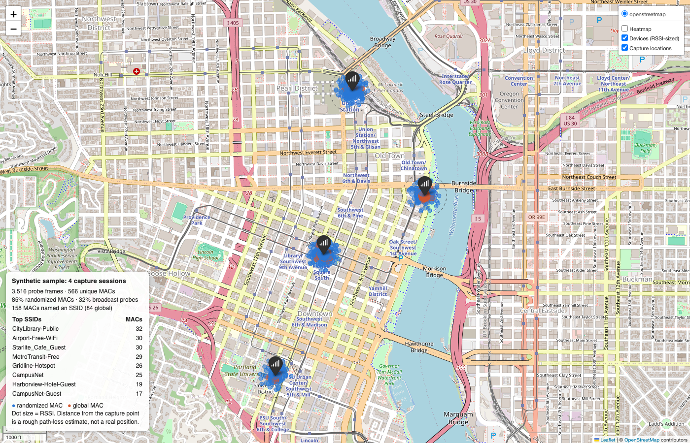
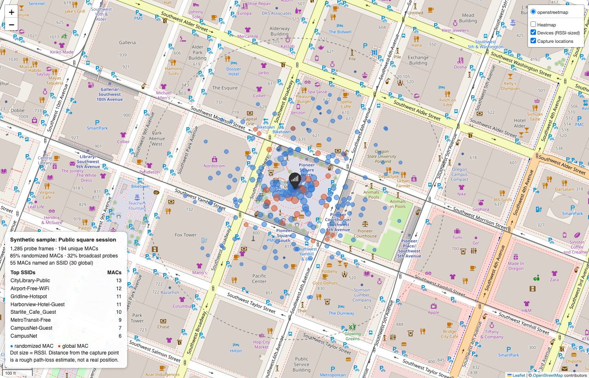

# eldrad-ulthran-probe-logger

**A passive WiFi probe request logger. It shows how much a phone or laptop says about you before it joins any network.**

Author: @alex_mh · Part of the [TrifoldPathSec](https://github.com/TrifoldPathSec) home-lab portfolio

> *Eldrad Ulthran*: the Farseer of Ulthwé, who read the future from faint threads no one else noticed. This tool reads the faint signals your devices send without being asked.



*Every MAC address and SSID in the screenshots, sample database and example map is synthetic. See [Sample data](#sample-data).*

---

## What it does

- **Captures** 802.11 probe request frames (management type 0, subtype 4). It only receives:
  - **Offline (tested)**: ingest a pcap recorded on a Hak5 WiFi Pineapple Pager over USB-C, after switching PineAP off ([how](docs/pineapple-pager.md)).
  - **Live**: sniff on a Linux monitor-mode interface (Raspberry Pi + USB adapter, or a Kali box) with channel hopping and a monitor-mode setup helper ([how](docs/live-capture-linux.md)).
- **Records**, for each frame: timestamp, a salted MAC token, the requested SSID (empty = broadcast probe), RSSI from the RadioTap header, channel, and whether the MAC is locally administered (randomized).
- **Stores** everything in SQLite, with CSV export.
- **Locates** frames with a fixed per-session lat/lon, or with a live fix from gpsd when a USB GPS is attached.
- **Maps** the results with Folium: a marker per capture location whose popup lists the SSIDs heard there, RSSI-sized device dots, an optional heatmap layer, and a stats panel.
- **Summarizes**: top SSIDs, unique MACs, the share of randomized MACs, and how many MACs gave away an SSID.



## Privacy by default

This project exists to show a privacy problem, so it tries not to become one.

| Default | Opt-in |
|---|---|
| **Receive only.** No injection, deauth, association or probe responses. The code never transmits. | none |
| The MAC is replaced with `HMAC-SHA256(per-session random salt, MAC)[:16]`. The salt lives only in memory, so tokens count devices within a session but can't be reversed or linked across sessions. | `--salt-file` keeps a persistent salt so tokens link across sessions |
| The raw MAC is **not stored**. Only the vendor OUI of globally administered MACs is kept. | `--store-raw-mac` (prints a warning) |
| Real captures go to `captures/`, which is git-ignored. | none |
| SSIDs are stored as heard, because they are the finding. | `map --redact-ssids` swaps them for short hashes before you share a map |
| Every SSID is HTML-escaped in the map. They are attacker-controlled bytes from the air, and a test covers this. | none |

## Legal and ethics

- Only capture where you are allowed to, and check your local law. Passively receiving radio traffic is treated differently around the world. Some places restrict storing or using intercepted identifiers even when receiving them is legal. In the US, the Wiretap Act and state laws apply. In the EU/UK, MAC addresses and SSIDs tied to a person can be personal data under GDPR.
- Use it to learn, for your own devices, or with permission. Don't track, profile or re-identify people. Don't correlate captures with other data to single anyone out.
- **Never publish real bystander MACs or SSIDs.** This repo contains synthetic data only. If you share results from a real capture, share aggregates or a `--redact-ssids` map.
- Delete raw captures when you're done with them. The Pineapple's own pcap still holds real MACs, so treat it like the raw data it is.

---

## What probe requests leak

### The mechanism

A WiFi client has two ways to find networks. It can wait for access points' **beacons** (passive scanning), or it can broadcast a **probe request** and wait for answers (active scanning). Phones prefer active scanning because it's faster. A probe request is an unencrypted management frame that anyone on the channel can hear. In a busy place, devices send dozens of them per minute, even when the screen is off.

Every probe request carries:

| Field | What it reveals |
|---|---|
| **Source MAC** (addr2) | A hardware identifier. If it's the real burned-in address, it's stable for the device's whole life, and its first three bytes (the OUI) name the manufacturer. |
| **SSID element** | Either empty (a *broadcast* or wildcard probe: "who's there?") or a specific network name (a *directed* probe: "is `HOME-4821` here?"). |
| **Supported rates, HT/VHT/HE capabilities, vendor elements** | Which elements appear, and in what order, depends on the chipset and driver. Even when the MAC is random, this is enough to fingerprint devices. |
| **Sequence number** | Often keeps counting across a MAC change, which links the "new" address to the old one. |
| **RSSI and timing** (measured by the receiver) | Rough distance from the sensor, and when the person was there. |

### Why directed probes are the real leak

A directed probe broadcasts an entry from the device's **preferred network list**: the names of networks it has joined before. A list like `HOME-4821`, `Harborview-Hotel-Guest`, `OakStreet-Gym` and `Riverside_Clinic_Guest` says where someone lives, travels, exercises and gets medical care. Home SSIDs are often unique enough to look up in public wardriving databases such as WiGLE, which turns one probe into a street address. Directed probes are also what made "Karma"-style rogue access points possible: a device that asks for `Starlite_Cafe_Guest` will connect to anything that answers with that name.

Modern operating systems mostly stopped sending directed probes. One exception is still common: **hidden networks**. An AP that doesn't broadcast its SSID can only be found by asking for it by name, so every device configured for one keeps naming it everywhere it goes. Older laptops, IoT devices, cars, printers and cheap Android builds still send directed probes for their whole list.

### How MAC randomization helps, and where it stops

Since iOS 8, Android 6/8+, Windows 10 and recent Linux NetworkManager, devices use a **random, locally administered MAC** while scanning. The second-lowest bit of the first octet (the U/L bit, `0x02`) is set, and the address changes every scan or every few minutes. iOS 14+ and Android 10+ also use a separate private address for each joined network. This tool flags that bit for every frame.

What it fixes:
- A sensor can't follow one hardware address across a city or across days.
- The OUI no longer names the vendor.
- Simple "unique device" counts stop meaning much. In the sample data, **85% of MACs are randomized**, and the 566 "unique MACs" come from roughly 245 simulated devices.

What it doesn't fix:
- **Directed probes still leak SSIDs**, random MAC or not. In the sample, 74 randomized MACs still named a (hidden) network.
- **IE fingerprints and sequence numbers** can re-link rotating MACs to one device ([Vanhoef et al., 2016](https://papers.mathyvanhoef.com/asiaccs2016.pdf); [Martin et al., 2017](https://arxiv.org/abs/1703.02874)).
- **Timing and RSSI** also cluster: a burst of new random MACs all at -48 dBm, a second apart, is almost certainly one phone.
- **Not every device randomizes.** IoT gear, older OS versions and some vendor builds still probe with their real address.
- **Once it associates**, a device uses a per-network address that stays the same for that network.

### What the sample data shows

```
frames                3516
unique MACs           566  (randomization inflates this; it is not a device count)
randomized MACs       85%
broadcast probes      32% of frames
MACs leaking SSIDs    158  (84 global, 74 randomized)
unique SSIDs          119
```

The synthetic population mirrors the pattern above: about two-thirds modern phones (random MAC that rotates each scan, mostly broadcast probes, 12% configured for a hidden network), about a fifth legacy clients (real MAC, directed probes for 2–7 saved networks), and about a tenth IoT devices (real MAC, repeatedly probing for one home network). Even a ~245-device crowd made up of fictional people leaks 119 distinct network names, and 84 devices did so under their permanent hardware address, which anyone could follow from one place to the next.

---

## Quick start

```bash
git clone https://github.com/TrifoldPathSec/eldrad-ulthran-probe-logger
cd eldrad-ulthran-probe-logger
python3 -m venv .venv && .venv/bin/pip install -r requirements.txt
```

### Rebuild the sample (no hardware needed)

```bash
.venv/bin/python -m eldrad synth --out samples
.venv/bin/python -m eldrad ingest --manifest samples/sessions.json --db samples/sample.db
.venv/bin/python -m eldrad stats --db samples/sample.db
.venv/bin/python -m eldrad map --db samples/sample.db --out docs/example_map.html
```

### From a WiFi Pineapple Pager capture

```bash
.venv/bin/python -m eldrad ingest captures/pager-2026-10-22.pcap --label "Coffee shop" --lat 45.5231 --lon -122.6765
.venv/bin/python -m eldrad stats
.venv/bin/python -m eldrad map --out captures/map.html
```

Full walkthrough: [docs/pineapple-pager.md](docs/pineapple-pager.md).

### Live on Linux (Raspberry Pi / Kali + monitor-mode adapter)

```bash
sudo .venv/bin/python -m eldrad monitor up wlan1
sudo .venv/bin/python -m eldrad capture --iface wlan1 --label "Bench test" --lat 45.5231 --lon -122.6765
sudo .venv/bin/python -m eldrad capture --iface wlan1 --gpsd --channels 1,6,11,36,44,149
sudo .venv/bin/python -m eldrad monitor down wlan1
```

Full walkthrough, including suggested adapter chipsets: [docs/live-capture-linux.md](docs/live-capture-linux.md).

### Commands

| Command | Purpose |
|---|---|
| `monitor up\|down\|status IFACE [--dry-run]` | Monitor-mode helper (`iw` + `ip`; releases the interface from NetworkManager) |
| `capture --iface IF [--lat/--lon] [--gpsd] [--channels] [--dwell] [--no-hop] [--duration]` | Live passive capture with channel hopping |
| `ingest PCAP... [--label --lat --lon] \| --manifest sessions.json` | Offline pcap/pcapng ingest |
| `stats [--json] [--top N]` | Summary statistics |
| `map [--out] [--redact-ssids] [--zoom]` | Folium map |
| `export --csv FILE` | CSV export |
| `synth [--out] [--seed]` | Generate synthetic sample pcaps |

`capture` and `ingest` also accept `--store-raw-mac` and `--salt-file`. Both are opt-in; see [Privacy by default](#privacy-by-default).

## How it works

```
 WiFi Pineapple Pager (tcpdump)        Linux + monitor-mode adapter
        │ pcap                          │ scapy sniff, ChannelHopper (iw set channel)
        ▼                               ▼
   eldrad ingest ────────────► frames.parse_probe ◄──────── eldrad capture
                                  │  type 0 / subtype 4, SSID IE, RadioTap dBm + freq,
                                  │  DS-param fallback for the channel, U/L bit
                                  ▼
                       privacy.MacAnonymizer (HMAC, per-session salt)
                                  │        location: fixed lat/lon or gpsd TPV
                                  ▼
                       store.ProbeStore (SQLite: sessions, probes) ──► CSV
                                  │
                   ┌──────────────┴──────────────┐
                   ▼                             ▼
             stats.summarize               mapgen.build_map (Folium)
                                    capture-location markers + SSID popups,
                                    RSSI-sized device dots, heatmap, stats panel
```

| Module | Role |
|---|---|
| [`eldrad/frames.py`](eldrad/frames.py) | Probe request parsing, frequency-to-channel mapping, randomized-MAC check |
| [`eldrad/privacy.py`](eldrad/privacy.py) | Salted MAC tokens, opt-in raw and persistent salt |
| [`eldrad/capture.py`](eldrad/capture.py) | Live sniffing, channel hopper, pcap ingest |
| [`eldrad/monitor.py`](eldrad/monitor.py) | Monitor-mode setup and teardown |
| [`eldrad/location.py`](eldrad/location.py) | Fixed location or gpsd client (no extra dependency) |
| [`eldrad/store.py`](eldrad/store.py) | SQLite schema and CSV export |
| [`eldrad/stats.py`](eldrad/stats.py) | Summary statistics |
| [`eldrad/mapgen.py`](eldrad/mapgen.py) | Folium map |
| [`eldrad/synth.py`](eldrad/synth.py) | Synthetic data generator |

**About the device dots:** with a fixed location, every frame in a session shares one coordinate. To make RSSI readable, each device is drawn at an *estimated* distance from the capture point, using a log-distance path-loss model (-40 dBm at 1 m, exponent 2.7) and a bearing derived from its token. The positions are illustrative and are not geolocation. With gpsd, each device is anchored at the fix where it was heard loudest.

## Sample data

`samples/` holds everything behind the screenshots:

- `pcap/session1-4.pcap`: synthetic RadioTap + 802.11 probe requests written with Scapy. They go through the same ingest path as a real capture.
- `sessions.json`: label, location and a fixed salt per session, so rebuilds are reproducible.
- `sample.db` / `sample.csv`: the ingested result.

Global MACs come from `00:00:5E:00:53:00–FF`, the IANA block reserved for documentation ([RFC 7042](https://www.rfc-editor.org/rfc/rfc7042)). Randomized MACs are random bytes with the U/L bit set. Every SSID is invented. The capture locations are public spots in downtown Portland, OR, picked only to give the map a realistic backdrop. No capture was made there.

## Tests

```bash
.venv/bin/python -m unittest discover -s tests -t . -v
```

The tests cover probe parsing (FCS frames, 5 GHz, broadcast SSIDs, non-probe frames), the randomized-bit check, salted tokens that don't link across sessions, no raw MAC stored by default, HTML escaping of hostile SSIDs, and the synthetic pcap round trip.

## Status and limits

- The pcap ingest, storage, stats and map are tested end to end on synthetic pcaps.
- Live Linux capture, its channel hopper and the monitor helper **haven't been run on hardware yet**. My kit doesn't have a Pi or a standalone adapter at the moment.
- The Pineapple Pager path is **tested on hardware** (firmware 24.10.1, 2026-10-22): a 5-minute capture over USB-C gave 334 probe requests with RSSI and channel on every frame. See [the guide](docs/pineapple-pager.md).
- No IE fingerprinting or sequence-number linking yet. Those are the obvious next steps for showing how randomization gets defeated.

## License

MIT. See [LICENSE](LICENSE).
